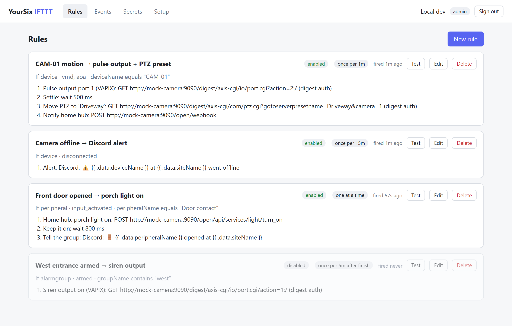
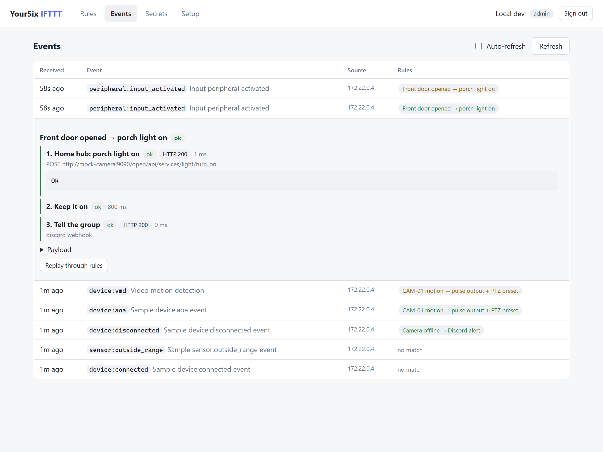
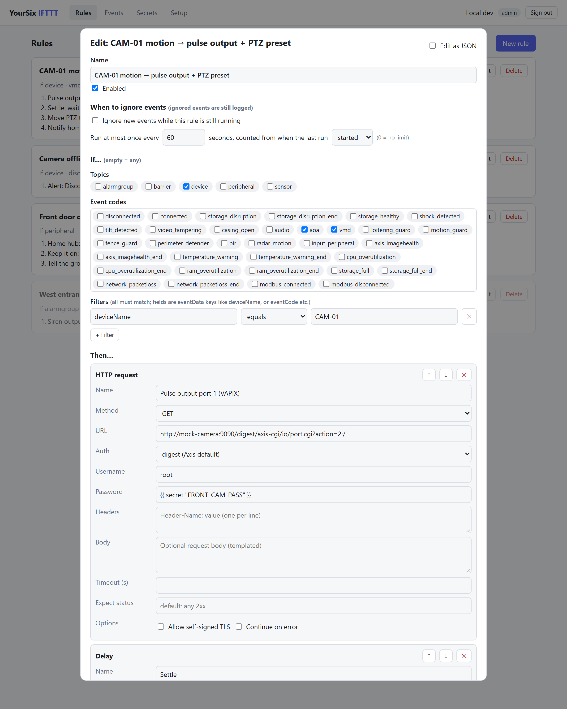
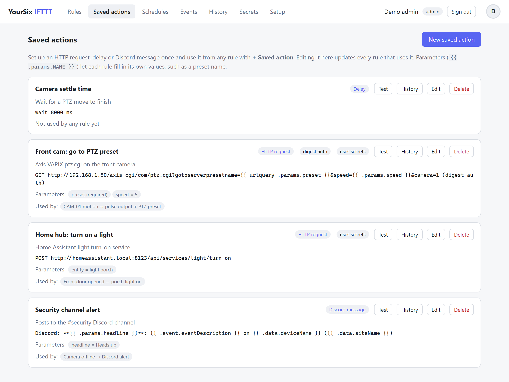
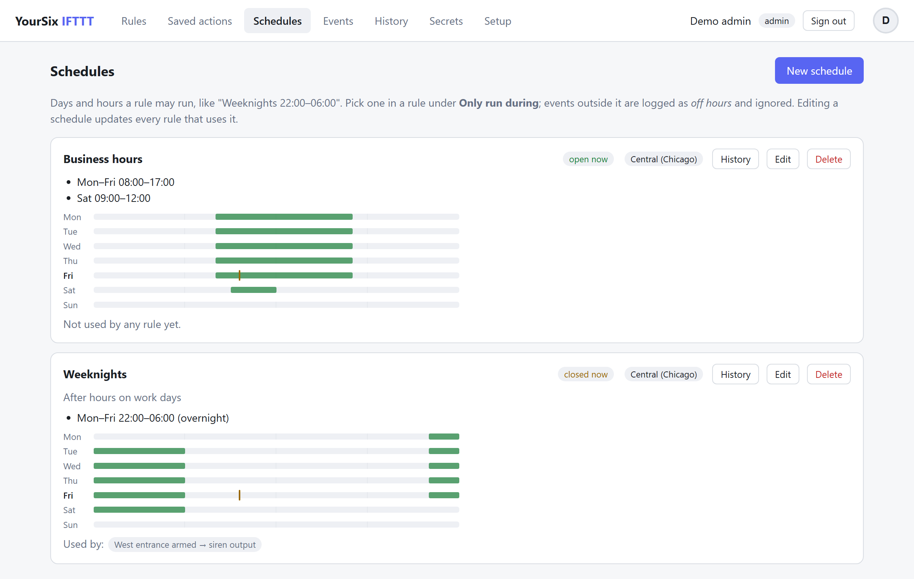
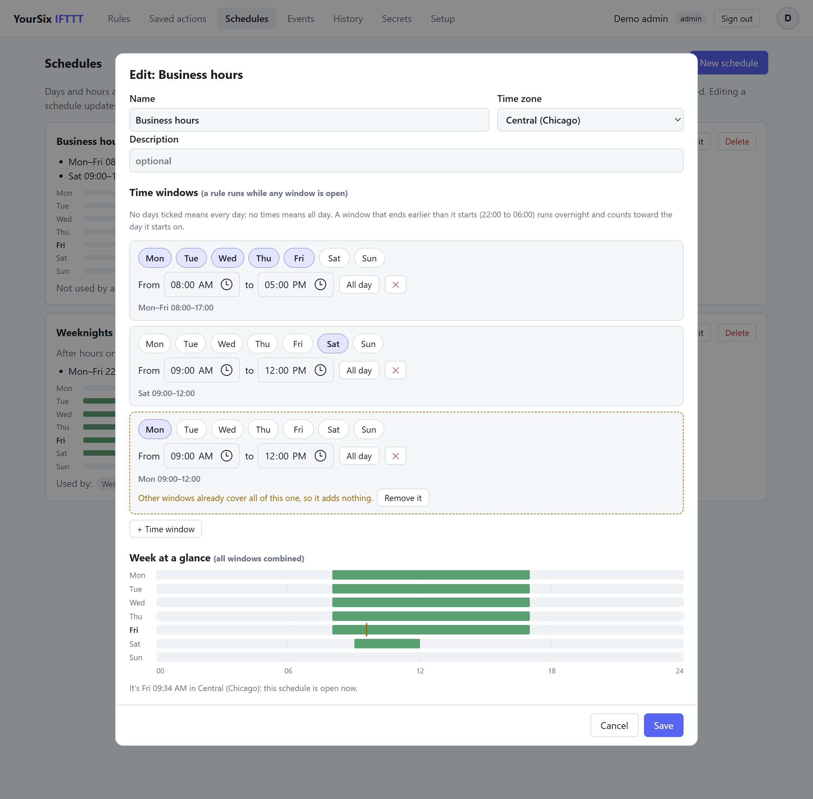
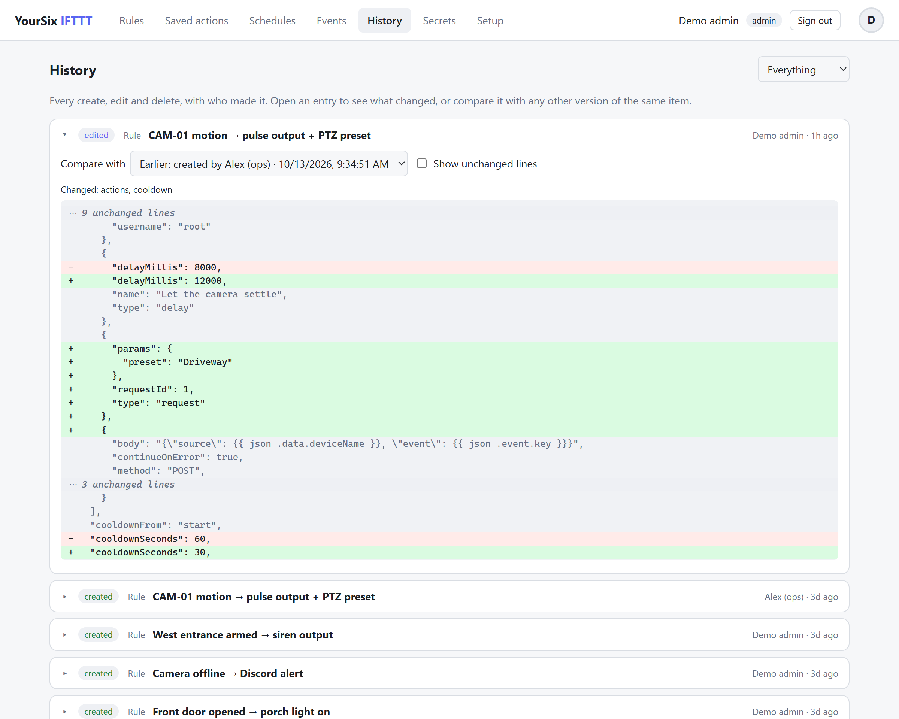
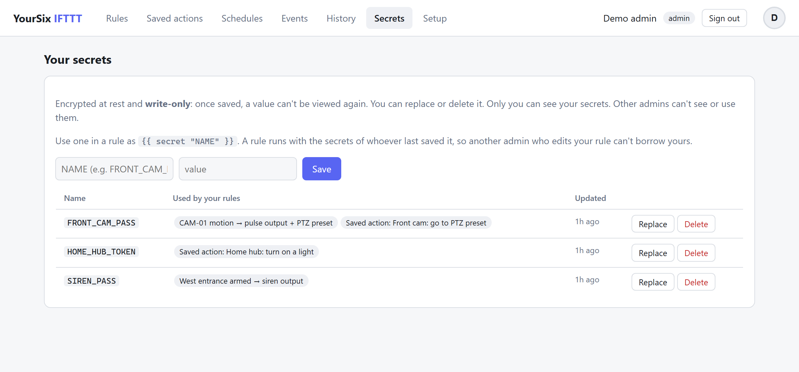
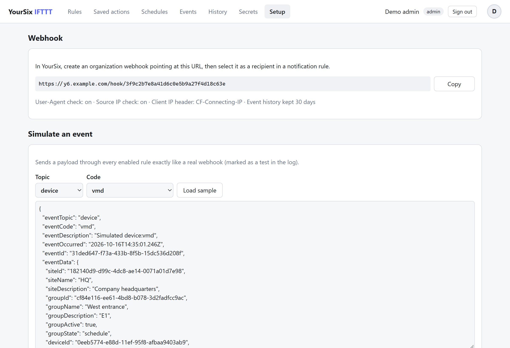

# YourSix IFTTT

A small Go service that receives [YourSix event webhooks](https://docs.yoursix.com/reference/events/intro) over a Cloudflare Tunnel and runs programmable actions on your local network. For example, a motion event on one camera can pulse an output on another camera, move a PTZ to a preset, call your home automation, or post to Discord.

**[Try the live demo ↗](https://coop25.github.io/yoursix-ifttt/)**: the real UI running entirely in your browser against a fake backend, with simulated YourSix events. Nothing talks to real devices.

- **Public:** `POST /hook/<token>` (the webhook receiver) and `GET /healthz`.
- **Behind Discord login:** the web UI for editing rules, a live event and run log (pushed from the server as things happen, no polling), testing rules, and simulating events.
- **Storage:** SQLite in a Docker volume. The image is a single static binary on distroless.

<picture>
  <source media="(prefers-color-scheme: dark)" srcset="docs/screenshots/rules-dark.png">
  
</picture>

## Screenshots

**Event log.** Every webhook is recorded with the rules it triggered, and new events and rule results appear live. Expand one to see each action's result, including any **If anything fails** actions. **Matrix ↗** opens the event's camera in the YourSix Matrix, playing back from when it happened. Search by code, device, site, rule name, source IP or anything in the payload, or by field (`device:CAM-01 site:"Head office" rule:gate status:failed`), and filter by outcome and date range. **Search tips** under the box lists every field.

<picture>
  <source media="(prefers-color-scheme: dark)" srcset="docs/screenshots/events-dark.png">
  
</picture>

**Rule editor.** Click a rule to open it. Pick topics and event codes from dropdowns (each choice shows as a removable pill), add filters, choose when to ignore events and which schedule it runs during, and build the action list from HTTP requests, delays, Discord messages and saved actions. **Preview templates** shows what each URL, header, body and message renders to. You can also switch to raw JSON.

<picture>
  <source media="(prefers-color-scheme: dark)" srcset="docs/screenshots/editor-dark.png">
  
</picture>

**Saved actions.** Set up an HTTP request, delay or Discord message once, with parameters, and reuse it from any rule.

<picture>
  <source media="(prefers-color-scheme: dark)" srcset="docs/screenshots/actions-dark.png">
  
</picture>

**Schedules.** Named days and hours that rules can run during, with a week at a glance and whether each is open now.

<picture>
  <source media="(prefers-color-scheme: dark)" srcset="docs/screenshots/schedules-dark.png">
  
</picture>

The schedule editor combines every time window into one weekly view and points out windows that add nothing.

<picture>
  <source media="(prefers-color-scheme: dark)" srcset="docs/screenshots/schedule-editor-dark.png">
  
</picture>

**History.** Every change to a rule, saved action or schedule, with who made it and a diff against any other version.

<picture>
  <source media="(prefers-color-scheme: dark)" srcset="docs/screenshots/history-dark.png">
  
</picture>

**Secrets.** Encrypted, write-only, and private to each admin.

<picture>
  <source media="(prefers-color-scheme: dark)" srcset="docs/screenshots/secrets-dark.png">
  
</picture>

**Setup.** Shows the webhook URL to paste into YourSix, and lets you simulate any event.

<picture>
  <source media="(prefers-color-scheme: dark)" srcset="docs/screenshots/setup-dark.png">
  
</picture>

The screenshots come from the demo build: `task screenshots` retakes all of them (it needs Chrome, Chromium or Edge).


## How rules work

A rule has an **If** part, a list of **Then** actions, and an optional cooldown.

**If:**
- **Topics** (`device`, `alarmgroup`, `barrier`, `peripheral`, `sensor`). Empty means any topic.
- **Event codes** (`vmd`, `aoa`, `input_activated`, …), either bare or qualified like `device:vmd`. Empty means any code.
- **Filters** on any `eventData` key (`deviceName`, `siteName`, `groupState`, `videoSourceId`, …) or top-level field (`eventCode`, …), using `equals`, `not_equals`, `contains`, `starts_with`, `regex`, `exists` or `not_exists`. Every filter must match.

**Then**, run in order:

| Type | What it does |
|---|---|
| `http` | Any method, URL, headers and body. Auth can be none, `basic`, or `digest` (Axis VAPIX default). Optional self-signed TLS, custom expected status codes, and a timeout. |
| `delay` | Waits N ms between steps. |
| `discord` | Posts a message and/or rich embeds to a Discord webhook (see below). |
| `request` | Runs a **saved action** (see below) with values for its parameters. |

By default a failing action stops the rule. Set `continueOnError` on an action to keep going after it fails.

**If anything fails** (`"onFailure": [...]`): actions to run after a step fails, e.g. a Discord alert or a saved action. They run once, after the rule's own actions, and their templates also see `{{ .failure.step }}` (the failed step's name), `{{ .failure.stepNumber }}` and `{{ .failure.error }}`. Their results appear in the run under *If anything fails*; the run still counts as failed.

**Discord options.** Besides the message, a `discord` action can set:

- **Ping users / Ping roles:** Discord IDs to mention. Mentions are blocked unless listed here, so a stray `@everyone` in event data can't ping anyone. Listed IDs are added to the start of the message if it doesn't mention them already. Pinging yourself in a private channel is an easy way to get a phone notification. **Allow @everyone / @here** turns those on.
- **Silent** (no push notification) and **Text-to-speech**.
- **Sender & thread:** override the webhook's username and avatar, post into a thread by ID, or start a forum post with a thread name.
- **Embeds** (up to 10): title and link, description, colour, timestamp (**Event time** fills in `{{ .event.eventOccurred }}`), author, footer, thumbnail, image, and name/value fields (inline or not).

Every text field is templated. Text longer than Discord's limits is cut short. In JSON these options go under `"discord"`:

```json
{ "type": "discord", "message": "Motion!", "discord": {
    "pingUsers": ["123456789012345678"], "username": "{{ .data.siteName }}",
    "embeds": [{ "title": "{{ .data.deviceName }}", "color": "#e5484d", "timestamp": "{{ .event.eventOccurred }}",
                 "fields": [{ "name": "Site", "value": "{{ .data.siteName }}", "inline": true }] }] } }
```

While a rule runs, the UI shows it live:

- The rule's card on the **Rules** tab is highlighted and reads, e.g., *Step 2 of 4 · Settle · 4.2s left*. Its finished steps are ticked and the current one is marked.
- The event's badge in the **Events** log shows, e.g., *2/4 · 4.2s*.
- **Delay** steps count down with a progress bar; other steps show elapsed time.

URL, body, header values, password and message are Go templates:

```
{{ .data.deviceName }}  {{ .data.siteName }}  {{ .event.eventCode }}  {{ .event.key }}  {{ .rule }}
{{ json .data.deviceName }}        -> "CAM-01"  (safe inside JSON bodies)
{{ urlquery .data.deviceName }}    -> URL-escaped
{{ secret "CAMERA_PASS" }}         -> your secret CAMERA_PASS (Secrets tab)
```

Rules can be edited in the form editor or as raw JSON (toggle in the editor). See [testdata/rules/motion-to-mock-camera.json](testdata/rules/motion-to-mock-camera.json) for an example.

**Preview templates** (a tick box above the actions) renders every URL, header, body and message as you type, against a sample event for the rule's trigger. Saved actions show their parameters and the values they produce. Secrets appear as `‹secret NAME›`; their values are never sent to the browser. Broken templates show their error in place.

**Edit conflicts.** If someone else saves a rule or saved action while you have it open, your save is refused instead of silently overwriting theirs. You can see what they changed, overwrite with your version, or load theirs. API clients opt in by sending the `updatedAt` they loaded; without it there's no check.

### Saved actions

The **Saved actions** tab holds reusable actions, so the same camera call or Discord webhook doesn't have to be copied into every rule. Each one has a name, an action (an HTTP request, a delay, or a Discord message with all its options), and optional **parameters**. Its templates use parameters as `{{ .params.NAME }}`, alongside the usual event data. (In the API and in rule JSON they're still called requests: `/api/requests`, and `"type": "request"` with a `requestId`.)

Rules use one with the **+ Saved action** button. Pick the saved action, then fill in its parameters; values can use event data, e.g. `preset = {{ .data.deviceName }}-view`. A parameter with a default is optional, and one without a default is required. Editing a saved action updates every rule that uses it. A saved action can't be deleted while rules still use it. Each one has its own **Test** button, which asks for parameter values first.

**Saved actions and secrets.** Parameters can change where an action goes, for example a `host` parameter in a URL. So:

- A saved action that uses secrets runs with the secrets of the admin who last saved it, and **only that admin's rules can use it**. This is checked when a rule is saved and again on every run.
- Saved actions without secrets can be used by anyone.
- Parameter values can't use `{{ secret }}`. Put the secret in the saved action itself.

### Schedules

The **Schedules** tab holds named sets of days and hours, like *Weeknights: Mon–Fri 22:00–06:00* or *Business hours: Mon–Fri 08:00–17:00 and Sat 09:00–12:00*. A rule picks one under **Only run during**, and runs only while one of its time windows is open; other events are logged as `offhours`. Editing a schedule updates every rule that uses it, and a schedule can't be deleted while rules use it.

Windows add together: a schedule is open while any of its windows is, so overlapping windows are fine. The editor shows a **week at a glance** (all windows combined, with a marker at the current time), flags a window that other windows already cover completely (it adds nothing, so you can remove it), and refuses a window whose start and end are the same time (clear both for all day). Schedule cards show the same weekly view.

Each schedule has a time zone, picked from a list (common US zones first). It defaults to Central time (`America/Chicago`). In each window, no days ticked means every day and no times means all day. A window that ends before it starts runs overnight and belongs to the day it starts on, so Friday 22:00–06:00 covers early Saturday. Cards show whether each schedule is open right now. API: `/api/schedules` (`{"name", "timezone", "windows": [{"days": ["mon"], "from": "22:00", "to": "06:00"}]}`).

### History

Every time a rule, saved action or schedule is created, edited or deleted, its content is saved to an edit log along with who made the change. Saves that change nothing aren't logged. The **History** tab lists every change, newest first. Each rule, saved action and schedule card also has a **History** button that shows just that item's changes. Open an entry to see a line-by-line diff against the previous version, or pick any other version to compare with. Rules and saved actions created before the log existed have their old state recorded the first time they change, so that first edit can still be compared. Passwords and `Authorization`, `Proxy-Authorization` and `X-Api-Key` header values typed straight into an action are shown as `‹hidden›` in the log, so a credential that's later moved into a secret, or deleted, doesn't stay readable there. `{{ secret "NAME" }}` references are kept, since they only name a secret. A change to a hidden value alone isn't logged. The log is kept forever; it isn't pruned with events. API: `GET /api/history?kind=rule|action|schedule&id=N&before=REVISION_ID`.

### Secrets

The **Secrets** tab (admins only) stores credentials such as camera passwords:

- **Encrypted at rest:** values are stored with AES-256-GCM using `Y6IFTTT_SECRETS_KEY`, which lives only in `.env`. Each value is bound to its owner and name, so a database row copied to another user or renamed won't decrypt. Without the key, the database (or a backup of it) reveals nothing.
- **Write-only:** the API never returns a value, not even to its owner. You can only replace or delete it.
- **Private to the admin who added it:** other admins can't list, use, replace or delete your secrets.
- **Usable only by your rules:** a rule runs with the secrets of the admin who last saved it. Saving a rule that references a secret you don't own is rejected. Another admin therefore can't edit your rule to send your password somewhere else; they'd have to save it, which makes it theirs, without your secrets. Unchanged rules still run as their owner, including via **Test** and replay.
- **Literal names only:** names must be quoted literals (`{{ secret "NAME" }}`), so a template can't probe for names dynamically.
- **Masked in history:** values used in a run are masked (`••••••`) in the run history if they show up in a URL, response or error. Values shorter than 4 characters aren't masked.

`Y6IFTTT_SECRET_*` environment variables still work as operator-wide secrets that any admin's rules can use. A stored secret with the same name takes precedence. Without `Y6IFTTT_SECRETS_KEY`, the Secrets tab is disabled and only env secrets work.

**Key handling:** if you lose or change the key, stored secrets can't be decrypted and must be re-entered. Back up `.env` separately from the data volume.

### Open in Matrix

Each event in the log has a **Matrix ↗** button, and its expanded view has **Open in Matrix ↗**. Both use YourSix's [Matrix deeplinks](https://docs.yoursix.com/reference/integration) to open the event's video, playing back from the moment it **occurred**:

- Events with a `videoSourceId` open that stream: `deviceIds=<deviceId>_<videoSourceId>`, using the payload's value as-is.
- Other device events open the whole device: `deviceIds=<deviceId>`.
- Alarm group events open the group: `alarmGroupId=<groupId>`.

The timestamp is in seconds with milliseconds, for example `1791996197.084`. Set `Y6IFTTT_YOURSIX_PLATFORM_URL` if your organization uses a different YourSix web address.

### Ignoring events (rate limiting)

Each rule can accept an event and log it without acting on it:

- **Ignore while running** (`"skipIfRunning": true`): if a run of this rule is still in progress, the event is logged as `busy` and nothing happens. Without this option, overlapping runs execute in parallel.
- **Run at most once every N seconds** (`"cooldownSeconds": N`): events inside the window are logged as `cooldown`. The window can start when the last run **started** (`"cooldownFrom": "start"`, the default) or when it **finished** (`"cooldownFrom": "finish"`). With `finish`, events that arrive while a run is still going are ignored too, because the window hasn't opened yet.
- **Only run during** a schedule (`"scheduleId": N`, see [Schedules](#schedules)): events while the schedule is closed are logged as `offhours`.

The options can be combined. Ignored events still appear in the Events tab with the reason. The rule's **Test** button skips all of these checks.

Duplicate deliveries (same `eventId`) are recorded once and never fire twice.

## Test environment

You need Docker and [Task](https://taskfile.dev). Discord and Cloudflare aren't needed.

```bash
task test:up
```

This starts the following at http://localhost:8088:
- **The app**, with dev auth: every local request is an admin. Dev auth refuses any request that came through Cloudflare.
- **A mock camera** at `http://mock-camera:9090` inside the network. `/digest/*` needs digest auth `root`/`pass`, `/basic/*` needs basic auth, and everything else is open.
- **One example rule**, seeded from `testdata/rules/`.

```bash
task test:fire                                   # send testdata/events/device-vmd.json
task test:fire EVENT=peripheral:input_activated  # or any topic:code sample
task test:camera                                 # see what the mock camera received
task test:down                                   # stop (task test:clean also wipes data)
```

The UI's Setup tab can also simulate any event, and each rule has a **Test** button that runs its actions with a sample event.

To run without Docker, use `task run` (dev auth on :8080). Use `task test` for the unit tests.

## Demo

The [live demo](https://coop25.github.io/yoursix-ifttt/) is the real UI from `internal/web/static`, with [`demo/mock-api.js`](demo/mock-api.js) standing in for the server: an in-browser imitation of the API, the rules engine (triggers, filters, cooldowns, ignore-while-running, schedules, saved actions, on-failure actions), history, search and the live event stream. It's published by the [Pages workflow](.github/workflows/pages.yml) whenever the UI or demo changes. Build it locally with `task demo` (output in `_site/`).

**Keeping the demo in step.** The mock re-implements the server's behaviour in JavaScript, so a server change the UI can see usually needs a matching mock change, or the demo quietly drifts. When you change the API or the engine:

- **New or changed endpoint:** add or update its route in the `routes` table in `mock-api.js`, with the same status codes and error shapes (`{"error": …}`, `409` with `conflict`/`current` for stale saves, `409` with `usedBy` for in-use deletes).
- **New rule, action or schedule field:** handle it in `normalizeRule`/`validateRule` (or the saved-action and schedule validators), in `runActions`/`runStep` if it changes how runs behave, and in the `previewAction` mirror of template preview if it's templated.
- **Anything that changes or deletes an item:** call `record(kind, item, change)` so the History tab sees it.
- **New event field or search key:** update `termMatches` (search) and `eventView`.
- **Logic the UI also needs** (like schedule time maths): put it in `internal/web/static/logic.js`, which both the UI and the mock load, and test it in `internal/web/jstest` (`task test:js`), rather than writing it twice.
- **Then check it:** `task demo`, open `_site/index.html` (or serve it), and try the feature. `task screenshots` exercises every tab too.

## Production

1. **Discord app:** in https://discord.com/developers/applications, go to OAuth2 and add the redirect `https://<your-host>/auth/callback`.
2. **Cloudflare Tunnel:** in Zero Trust, go to Networks → Tunnels and create a tunnel. Add a public hostname pointing to `http://app:8080`, then copy the tunnel token.
   - Don't put Cloudflare Access in front of `/hook/*`, because YourSix can't log in. Protecting the rest with Access is optional, since the app has its own Discord login.
3. **Configure:** copy `.env.example` to `.env` and fill it in. Generate the webhook token and session secret with `openssl rand -hex 32`.
4. **Start:** `task up`. This runs `docker compose pull && up -d` for the app and cloudflared. No ports are published on the host.
5. **YourSix:** create an organization webhook to `https://<your-host>/hook/<Y6IFTTT_WEBHOOK_TOKEN>`. The UI's Setup tab shows this URL. Then add the webhook as a recipient in a notification rule, choosing which events to send.

The app container must be able to reach your cameras. The default bridge network can reach LAN IPs through the host. If you need mDNS or broadcast, switch to `network_mode: host`.

### Webhook security

YourSix webhooks carry no signature. The documentation only gives the `y6-platform` User-Agent and the source IPs from the A record of `webhook.cloud.yoursix.com`. This service layers the available checks:

1. An unguessable token in the URL path (required, at least 24 chars). A wrong token gets a 404.
2. A User-Agent check (`Y6IFTTT_WEBHOOK_REQUIRE_USER_AGENT`, on by default).
3. A source IP check against the resolved A record, using `CF-Connecting-IP` behind the tunnel (`Y6IFTTT_WEBHOOK_VERIFY_SOURCE_IP`).
4. A body size limit, plus dedupe on `eventId`.

The UI uses Discord OAuth (`identify` scope only) with HMAC-signed session cookies. Roles come from `Y6IFTTT_ADMIN_USER_IDS` and `Y6IFTTT_VIEWER_USER_IDS` and are checked on every request, so removing an ID revokes access. State-changing requests are protected against cross-site requests with Go's `http.CrossOriginProtection`, and a strict CSP is set.

## Releasing

Publish a GitHub release tagged `vX.Y.Z`. The [release workflow](.github/workflows/release.yml) tests the code, builds `linux/amd64` and `linux/arm64` images, and pushes them to `ghcr.io/<owner>/<repo>` as `X.Y.Z`, `X.Y`, `X` and `latest`. Pre-releases get only their exact tag. CI also runs on every push and pull request.

## Configuration reference

All settings are environment variables prefixed `Y6IFTTT_`. See [.env.example](.env.example) for the full list.

| Variable | Default | Purpose |
|---|---|---|
| `ADDR` | `:8080` | Listen address |
| `DATA_DIR` | `data` | SQLite location |
| `PUBLIC_URL` | | External base URL, also used to derive the OAuth redirect |
| `WEBHOOK_TOKEN` | required | Secret path segment of the webhook URL |
| `WEBHOOK_REQUIRE_USER_AGENT` | `true` | Require `y6-platform` User-Agent |
| `WEBHOOK_VERIFY_SOURCE_IP` | `false` | Require a YourSix source IP |
| `CLIENT_IP_HEADER` | | Trusted header for the client IP (`CF-Connecting-IP`) |
| `DISCORD_CLIENT_ID` / `_SECRET` | required | Discord OAuth app |
| `SESSION_SECRET` | required | At least 32 chars, signs session cookies |
| `ADMIN_USER_IDS` / `VIEWER_USER_IDS` | | Allowed Discord user IDs |
| `DISCORD_WEBHOOK_URL` | | Default target for Discord message actions |
| `SECRET_*` | | Values exposed to templates via `{{ secret "*" }}` |
| `EVENT_RETENTION_DAYS` | `30` | Event and run history retention |
| `SECRETS_KEY` | | 32-byte key (hex/base64) enabling the encrypted Secrets tab |
| `YOURSIX_PLATFORM_URL` | `https://platform.yoursix.com` | YourSix web app for "Open in Matrix" links |
| `SEED_RULES_DIR` | | Import `*.json` rules on first start (empty DB only) |
| `DEV_AUTH` | `false` | Local testing only: skip Discord login |
